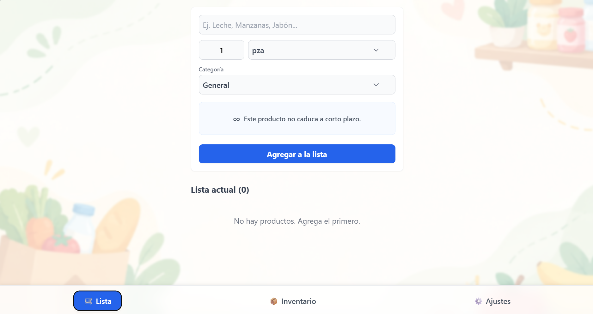

**Nota:** Este artículo forma parte de la documentación académica del proyecto "Gestor Doméstico", desarrollado para la materia de Aplicaciones Web Progresivas en la Universidad Tecnológica Fidel Velázquez.

**Resumen del proyecto:** Gestor Doméstico es una Aplicación Web Progresiva (PWA) diseñada para centralizar la administración del hogar. A través de un enfoque *offline-first*, la aplicación permite gestionar listas de compras, controlar el inventario de la despensa y recibir alertas de caducidad, todo ello sin depender de una conexión permanente a internet. Su arquitectura combina la accesibilidad de la web con la resiliencia de las aplicaciones nativas.

## Objetivos

1.  **Centralizar la gestión del hogar:** Unificar en una sola herramienta la lista de compras, el inventario de la despensa y los recordatorios de caducidad, eliminando la fragmentación de usar notas en papel o aplicaciones dispersas.
2.  **Garantizar el funcionamiento offline:** Implementar una arquitectura *offline-first* que asegure que la aplicación sea totalmente funcional en contextos donde la conectividad es nula o inestable, como un supermercado con mala señal.
3.  **Ofrecer una experiencia instalable y nativa:** Utilizar las capacidades de las PWA para que el usuario pueda instalar la aplicación en su dispositivo, acceder a ella desde la pantalla de inicio y utilizarla a pantalla completa, sin necesidad de tiendas de aplicaciones.

## Características principales (Features)

1.  **Gestión de Lista de Compras con Categorías:**
    *   Los usuarios pueden agregar productos a una lista, organizándolos por categorías (frutas, lácteos, limpieza, etc.).
    *   La lista permite gestionar cantidades y unidades de medida (piezas, kilogramos, litros).
    *   Los productos se pueden editar o eliminar antes de confirmar la compra.

2.  **Inventario de Despensa con Alertas Visuales:**
    *   Al confirmar la compra, los productos se transfieren automáticamente al inventario de la despensa.
    *   El inventario clasifica los productos según su fecha de caducidad: verde (en buen estado), amarillo (próximo a caducar en 10 días o menos) y rojo (caducado).
    *   Los productos que no caducan (como artículos de limpieza) se marcan con un indicador especial.

3.  **Notificaciones Nativas de Caducidad:**
    *   Utilizando la **Notifications API**, la aplicación alerta al usuario sobre los productos que están a punto de caducar, ayudando a reducir el desperdicio de alimentos.

4.  **Funcionamiento Offline Completo:**
    *   Gracias a un **Service Worker** configurado con Workbox, la aplicación cachea el *App Shell* y los recursos estáticos.
    *   Los datos se almacenan localmente en **IndexedDB** (a través de Dexie.js), lo que permite realizar operaciones de lectura y escritura sin conexión.

5.  **Instalación y Actualización Controlada:**
    *   La aplicación es instalable en dispositivos Android e iOS (a través de "Agregar a pantalla de inicio").
    *   Incluye un sistema de actualización que notifica al usuario cuando hay una nueva versión disponible, permitiéndole decidir cuándo actualizar.

## Stack Tecnológico

*   **Frontend:** React con Vite, utilizando React Router para la navegación y Tailwind CSS para un diseño responsive y moderno.
*   **Base de Datos Local:** IndexedDB, gestionado a través de la librería Dexie.js para simplificar las consultas y transacciones.
*   **PWA:** `vite-plugin-pwa` para la generación del Service Worker y el Manifest, con estrategias de caché configuradas mediante Workbox.
*   **Notificaciones:** Notifications API nativa del navegador.
*   **Despliegue:** Vercel, aprovechando su integración con Vite y su HTTPS automático.
*   **Pruebas:** Vitest para pruebas unitarias e integración, Playwright para pruebas E2E y Lighthouse para auditorías de rendimiento y PWA.

## Ejemplo de Configuración (Código)

A continuación, se muestra un fragmento del `vite.config.js` que configura el Service Worker y el Manifest de la PWA, aplicando estrategias de caché para garantizar el funcionamiento offline.

```javascript
// vite.config.js (fragmento)
import { defineConfig } from 'vite'
import react from '@vitejs/plugin-react'
import { VitePWA } from 'vite-plugin-pwa'

export default defineConfig({
  plugins: [
    react(),
    VitePWA({
      registerType: 'prompt',
      manifest: {
        name: 'Gestor Doméstico',
        short_name: 'GestorHogar',
        description: 'Gestión de listas de compra e inventario offline-first',
        theme_color: '#2563eb',
        background_color: '#ffffff',
        display: 'standalone',
        orientation: 'portrait',
        icons: [
          { src: 'pwa-192x192.png', sizes: '192x192', type: 'image/png' },
          { src: 'pwa-512x512.png', sizes: '512x512', type: 'image/png' },
        ],
      },
      workbox: {
        globPatterns: ['**/*.{js,css,html,ico,png,svg}'],
        runtimeCaching: [
          {
            urlPattern: ({ request }) => request.destination === 'document',
            handler: 'NetworkFirst',
            options: { cacheName: 'html-cache' },
          },
          {
            urlPattern: ({ request }) =>
              ['style', 'script', 'worker'].includes(request.destination),
            handler: 'StaleWhileRevalidate',
            options: { cacheName: 'assets-cache' },
          },
        ],
      },
    }),
  ],
})