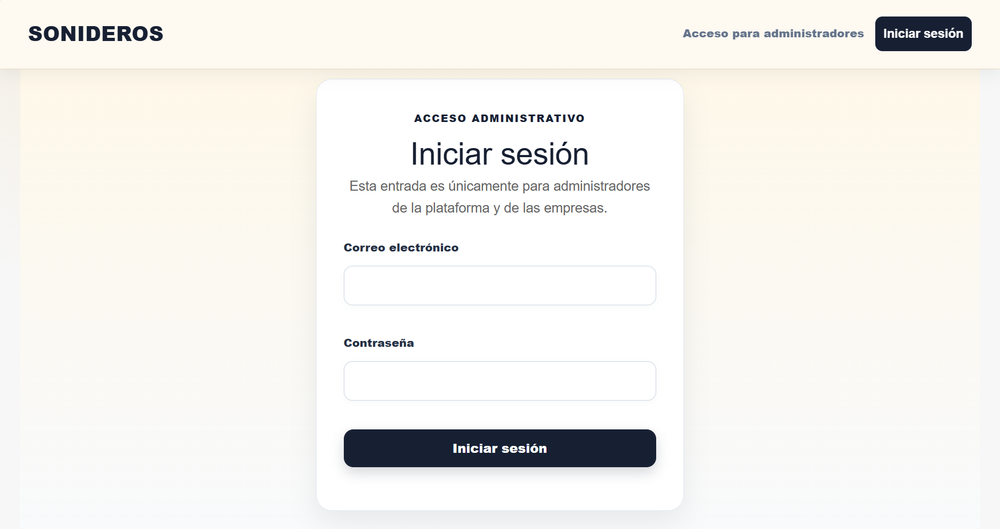

**Nota:** Este artículo forma parte de la documentación del proyecto **"SONIDEROS"**, una plataforma SaaS (Software as a Service) desarrollada para digitalizar la operación de empresas dedicadas al sonido, iluminación y organización de eventos en México.

**Resumen del proyecto:** SONIDEROS es una PWA tipo SaaS que permite a los sonideros rentar una página web pública personalizable, gestionar su catálogo de paquetes y servicios, definir su cobertura geográfica y recibir reservas de clientes. A cambio, pagan una suscripción mensual de $299 MXN (con oferta de lanzamiento de $199 MXN por 3 meses para las primeras 10 empresas). Los clientes, por su parte, tienen una cuenta global para explorar el directorio de sonideros y solicitar fechas para sus eventos.

## El problema que resuelve

Antes de SONIDEROS, los sonideros en México enfrentaban una **doble problemática**:

1.  **Presencia digital fragmentada:** La mayoría dependía exclusivamente de redes sociales (Facebook, WhatsApp) para promocionarse. No tenían un catálogo formal de paquetes ni un lugar centralizado donde los clientes pudieran comparar opciones.
2.  **Gestión de reservas caótica:** Las solicitudes de eventos se manejaban por mensajes directos, lo que provocaba **empalmes de horarios**, pérdida de información del cliente y una nula trazabilidad del anticipo y saldo.

Los problemas más frecuentes eran:
- **Doble agendamiento** de fechas por falta de un calendario unificado.
- **Pérdida de clientes** porque no había una respuesta rápida y formal a las solicitudes.
- **Falta de identidad visual** en las páginas de los sonideros, que no reflejaban su estilo (luces, colores, temática).
- **Imposibilidad de mostrar** la cobertura geográfica (estados y municipios) de manera clara.

SONIDEROS nace para **centralizar la oferta, estandarizar las reservas y profesionalizar la imagen** de las empresas de entretenimiento.

## Objetivos

1. **Proporcionar una página pública personalizable:** Cada empresa recibe un "micrositio" con URL amigable (ej. `/sonido-dragon`), donde puede mostrar su logo, elegir una de tres paletas de colores, listar sus paquetes y subir su galería de fotos.
2. **Automatizar la gestión de reservas:** Implementar un flujo con reglas de negocio estrictas: bloqueo de los próximos 5 días, límite de 45 días de anticipación, expiración de solicitudes pendientes a las 32 horas y cálculo automático del anticipo (50%).
3. **Garantizar el aislamiento de datos:** Cada sonidero gestiona únicamente su información. Un cliente que navega en `sonido-dragon` no ve los paquetes de `sonido-patitos`.

## Características principales de la PWA (Features)

1. **Panel de administración para la empresa:**
   *   **Identidad visual:** Selector de paletas (Noche Dorada, Morado Neón, Turquesa Tropical) que se aplican dinámicamente a la página pública.
   *   **Catálogo de paquetes:** Creación de paquetes con título, precio, duración en horas y lista de "ideas" o inclusiones.
   *   **Gestión de cobertura:** Configuración de estados y municipios donde opera el sonidero.
   *   **Gestión de reservas:** Bandeja de entrada con las solicitudes de los clientes, con botones para **Aceptar** (bloquea la fecha permanentemente) o **Rechazar** (libera la fecha).

2. **Experiencia del cliente (PWA instalable):**
   *   **Cuenta global única:** El cliente se registra una vez y puede reservar con cualquier empresa.
   *   **Formulario de reserva guiado:** Un asistente paso a paso que selecciona el paquete, la fecha, el tipo de evento, el método de pago (efectivo o transferencia) y la ubicación dentro de las zonas de cobertura.
   *   **Vista offline (Service Worker):** Al instalar la PWA, los clientes pueden consultar sus reservas y los catálogos de paquetes incluso sin conexión a internet, ya que los recursos estáticos se almacenan en caché.

3. **Seguridad de nivel bancario:**
   *   **Protección CSRF:** Todos los formularios incluyen tokens únicos para prevenir ataques.
   *   **Hash de contraseñas:** Las contraseñas se almacenan usando el algoritmo Bcrypt.
   *   **Validación en servidor:** No se confía en el JavaScript; todas las reglas de negocio se revalidan en el backend.

4. **Notificaciones automáticas por correo:**
   *   La plataforma envía correos automáticos a la empresa cuando recibe una nueva solicitud y al cliente cuando su reserva es confirmada o rechazada, usando la librería PHPMailer.

## Ventajas frente a apps nativas y webs tradicionales

| Aspecto | Web tradicional | App nativa | PWA (SONIDEROS) |
|---|---|---|---|
| **Instalación** | No requiere | Requiere tienda de apps | Instalable desde el navegador (sin tiendas) |
| **Acceso** | Necesita navegador y conexión | Depende del sistema operativo | Accesible desde la pantalla de inicio |
| **Actualizaciones** | Automáticas | Manuales o por tienda | Automáticas vía service worker |
| **Costo de desarrollo** | Bajo | Alto (iOS y Android por separado) | Único código para múltiples plataformas |
| **Funcionamiento offline** | Limitado | Sí | Sí, con service worker y caché |
| **Distribución** | URL | Tiendas de aplicaciones | URL + instalación directa |

Para un sonidero, una PWA como SONIDEROS ofrece **presencia profesional** (página web propia), **ahorro de tiempo** (gestión de reservas automatizada), **menos errores** (validación de fechas y zonas) y **actualización sencilla** (cambios reflejados inmediatamente).

## Casos de uso reales

Según la información del proyecto, SONIDEROS tiene dos grandes casos de uso:

- **Para la empresa (Administrador de Sonidero):**
  *   Configurar su catálogo de servicios y paquetes.
  *   Definir sus zonas de cobertura (ej. "Estado de México, Nicolás Romero").
  *   Revisar las solicitudes de reserva y decidir si acepta o rechaza.
  *   Consultar el estado de pago (anticipo y saldo pendiente).

- **Para el cliente:**
  *   Explorar el directorio de sonideros disponibles.
  *   Consultar la galería de fotos y los paquetes de cada empresa.
  *   Solicitar una reserva en 4 pasos, indicando tipo de evento (boda, cumpleaños, etc.).
  *   Consultar el estado de sus reservas y cancelar solicitudes pendientes.

> **Delimitante:** SONIDEROS **no procesa pagos automáticamente**. La plataforma calcula el anticipo (50%) y el saldo, pero el pago se coordina directamente entre la empresa y el cliente.

## Stack Tecnológico

*   **Backend:** PHP 8.x con arquitectura MVC personalizada (sin frameworks pesados).
*   **Base de Datos:** MySQL / MariaDB (InnoDB, utf8mb4).
*   **Frontend:** HTML5, CSS3 (con variables nativas y `color-mix`), JavaScript Vanilla (ES6+).
*   **Librerías Backend (Composer):** `phpmailer/phpmailer` para notificaciones SMTP.
*   **Librerías Frontend:** Bootstrap 5.3.6 (alojado localmente).
*   **Seguridad:** Tokens CSRF, Hash Bcrypt, PDO con *prepared statements*.
*   **Migraciones:** Clase `SchemaMigrator` para actualizar la BD sin perder datos.

## Ejemplo de Configuración (Código)

A continuación se muestra un ejemplo básico de cómo se estructuraría el `manifest.json` y un service worker para la PWA de SONIDEROS.

```json
// manifest.json (ejemplo para SONIDEROS)
{
  "name": "SONIDEROS - Renta de Sonido y Eventos",
  "short_name": "SONIDEROS",
  "description": "Encuentra sonideros, compara paquetes y reserva tu evento.",
  "start_url": "/",
  "display": "standalone",
  "background_color": "#f8fafc",
  "theme_color": "#172033",
  "orientation": "portrait",
  "icons": [
    { "src": "/icons/icon-192x192.png", "sizes": "192x192", "type": "image/png" },
    { "src": "/icons/icon-512x512.png", "sizes": "512x512", "type": "image/png" }
  ]
}